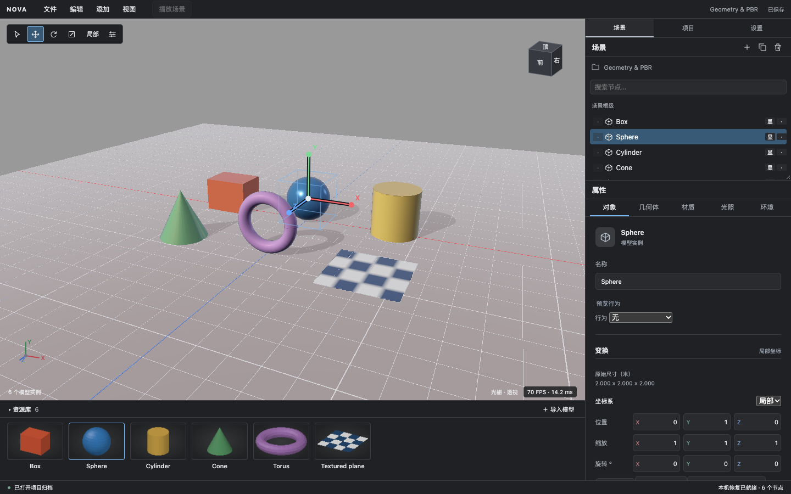

# Nova Editor

基于 Nova Render 的 3D 场景编辑器，支持桌面端和浏览器。可以导入模型、布置场景、编辑材质和灯光，再保存项目或导出 GLB。

[在线使用](https://eric-schecter.github.io/nova-editor/) · [下载桌面版](https://github.com/Eric-Schecter/nova-editor/releases)



## 主要功能

- 场景树、视口选取、多选变换、网格吸附和表面摆放。
- 可编辑的材质、灯光和相机。支持视口点选灯光目标、动画预览及透视／正交切换。
- 支持 glTF、GLB、OBJ、STL 导入导出，FBX 与 GLB 转换，以及 STEP 导入。
- 桌面端和网页端使用同一项目格式，并提供本地恢复。

界面默认英文，可在 **Settings → Language** 切换为简体中文。

## 本地运行

需要 Node.js、pnpm。桌面构建还需要 CMake 和 C++17 工具链。首次构建网页 FBX 转换器需要 Emscripten。

```sh
pnpm install --frozen-lockfile
pnpm sdk:install
```

**网页端**运行 `pnpm dev:web`，用支持 WebGPU 的浏览器打开终端显示的地址。

**桌面端**在 macOS 上运行：

```sh
cmake -S . -B build -DCMAKE_BUILD_TYPE=Release
cmake --build build --target nova_editor -j 6
./build/nova_editor.app/Contents/MacOS/nova_editor
```

Windows 和 Linux 构建的可执行文件位于构建目录。桌面端打开 `project.json`，网页端打开项目 ZIP。要在桌面端打开网页保存的项目，解压 ZIP 后打开其中的 `project.json`，并将 `assets/` 留在同一目录。

SDK 下载和版本锁定见 [SDK 安装说明](docs/SDK-DOWNLOAD.md)。开发细节见 [工程架构](ARCHITECTURE.md) 和 [验证记录](docs/VALIDATION.md)。
